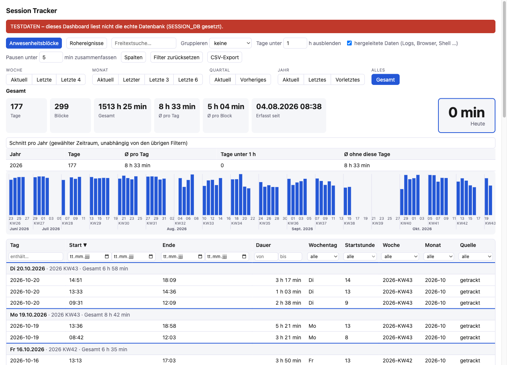
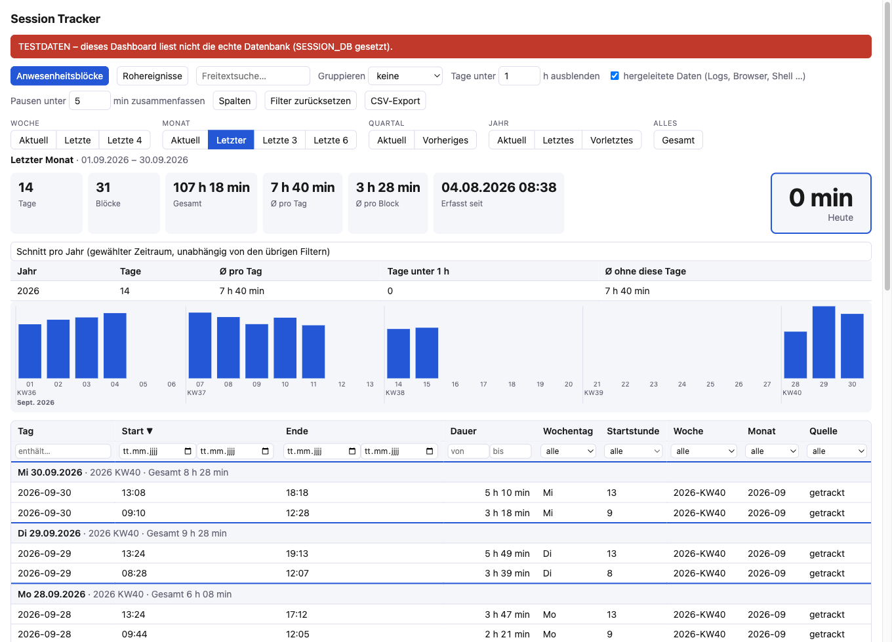

# session-tracker

[](https://github.com/hpmartini/session-tracker/actions/workflows/ci.yml)
[](LICENSE)


Presence and working-time tracker for macOS. A tiny background process records when you log in, lock, sleep or wake your Mac. A CLI report and a local web dashboard turn those events into presence blocks, daily totals and averages. Everything stays on your machine.

> The dashboard and report output are in German.



*Screenshots show synthetic demo data (see [Try it with demo data](#try-it-with-demo-data)), not a real person's working times. The red banner marks a dashboard that reads a test database.*

## What it does

- **Tracker** (`tracker/session-tracker.swift`): a LaunchAgent that writes events (`start`, `unlock`, `lock`, `sleep`, `wake`, `display_on`, `display_off`, `logout`, `stop`, heartbeats) to a local SQLite file.
- **Report** (`bin/session-report`): builds presence blocks from the events, merges pauses shorter than a threshold (default 5 min) and prints per-day totals plus a per-year table (average per day, days under a threshold, average without those days).
- **Dashboard** (`bin/session-dashboard`, `dashboard/dashboard.html`): local web UI on `http://127.0.0.1:8765` with blocks, raw events, filters, CSV export, a "today" tile that refreshes every minute and 13 period selectors (current/previous week, month, quarter, year, last 4 weeks, last 3/6 months, all time).
- **Backfill** (`bin/session-backfill`, optional): derives *estimated* working times for the time before tracking started from traces macOS and your apps already keep: app usage (knowledgeC), unlock events in the unified log, browser history (Chrome, Arc, Brave, Edge, Safari, Firefox), shell history, Claude Code prompts and downloads. Stored separately in the table `derived` and marked as derived (`~`, "hergeleitet"). Off by default, never mixed into tracked data. SSH logins are not read from system logs.



## Install

Requires macOS, `python3` and the Xcode command line tools (`swiftc`).

```sh
git clone https://github.com/hpmartini/session-tracker.git
cd session-tracker
./install.sh
```

This copies the tools to `~/.local/bin`, the dashboard to `~/.local/share/session-tracker`, compiles the tracker and loads two LaunchAgents (`dev.hpmartini.session-tracker` and `dev.hpmartini.session-dashboard`). Data lives in `~/.local/share/session-tracker/events.sqlite`.

To uninstall:

```sh
for n in session-tracker session-dashboard; do
  launchctl bootout "gui/$(id -u)/dev.hpmartini.$n"; rm ~/Library/LaunchAgents/dev.hpmartini.$n.plist
done
rm ~/.local/bin/session-{tracker,report,dashboard,backfill}   # data stays in ~/.local/share/session-tracker
```

## Usage

```sh
session-report                          # per-day totals, tracked data only
session-report --bloecke                # also list every block
session-report --zeitraum letzter_monat # restrict to a period
session-report --pause 10 --kurz 2      # merge pauses < 10 min, count days < 2 h as short
session-report --hergeleitet            # add derived (estimated) days before tracking started
session-backfill                        # fill the derived table (optional; one source: session-backfill shell_history)
session-report --selftest               # run the built-in checks
```

Example output (demo data):

```text
$ session-report --zeitraum letzter_monat
2026-09-01 Tue  09:04–17:18    7:06 h  2 Blöcke
2026-09-02 Wed  08:37–17:10    7:42 h  2 Blöcke
2026-09-03 Thu  08:24–17:35    8:00 h  3 Blöcke
…
Jahr   Tage    Ø/Tag   Tage <1 h   Ø/Tag ohne diese
2026     14    7:40 h          0       7:40 h
```

Periods for `--zeitraum`: `woche`, `letzte_woche`, `vier_wochen`, `monat`, `letzter_monat`, `drei_monate`, `sechs_monate`, `quartal`, `vorquartal`, `jahr`, `letztes_jahr`, `vorletztes_jahr`, `gesamt`. Weeks start on Monday, quarters are calendar quarters, "last N weeks/months" roll up to and including today. The dashboard uses the same definitions.

## Try it with demo data

No tracking needed. `scripts/make-demo-db.py` writes a synthetic database (fixed seed, fake working days, a fake vacation, fake derived evidence):

```sh
python3 scripts/make-demo-db.py /tmp/demo.sqlite
SESSION_DB=/tmp/demo.sqlite bin/session-dashboard 8791   # open http://127.0.0.1:8791
```

The dashboard needs the tools installed in `~/.local/bin` (run `./install.sh` once) because it imports `session-report` from there.

## Limits you should know

- Presence is not work. A block means the Mac was unlocked and awake, not that you were productive.
- Derived data is a heuristic. App usage may include passive foreground time, shell history cannot tell SSH input from local input, and each trace is padded by 5 minutes. It only covers the time before the first tracked event.
- Averages count days with evidence, not calendar days: weekends, holidays and vacation are not modeled.
- `session-backfill` ignores timestamps before `MACHINE_SINCE` (top of the file, set to the setup date of the author's Mac). Adjust it for yours.
- The dashboard binds to `127.0.0.1` only and has no authentication.

## Privacy

Only timestamps are read, never URLs, file contents or commands. The backfill reads your browser and shell history databases locally; nothing is sent anywhere.

## Tests

`session-report --selftest` covers block building, merging, derived blocks, the year table, clipping and the period definitions. CI also type-checks the Swift tracker and syntax-checks the installer. There are no automated tests for the dashboard UI.

## Contributing

Issues and pull requests are welcome, see [CONTRIBUTING.md](CONTRIBUTING.md). Please read the [Code of Conduct](CODE_OF_CONDUCT.md). Report security problems as described in [SECURITY.md](SECURITY.md). Changes are listed in [CHANGELOG.md](CHANGELOG.md).

## License

[MIT](LICENSE) © Hans-Peter Martini
